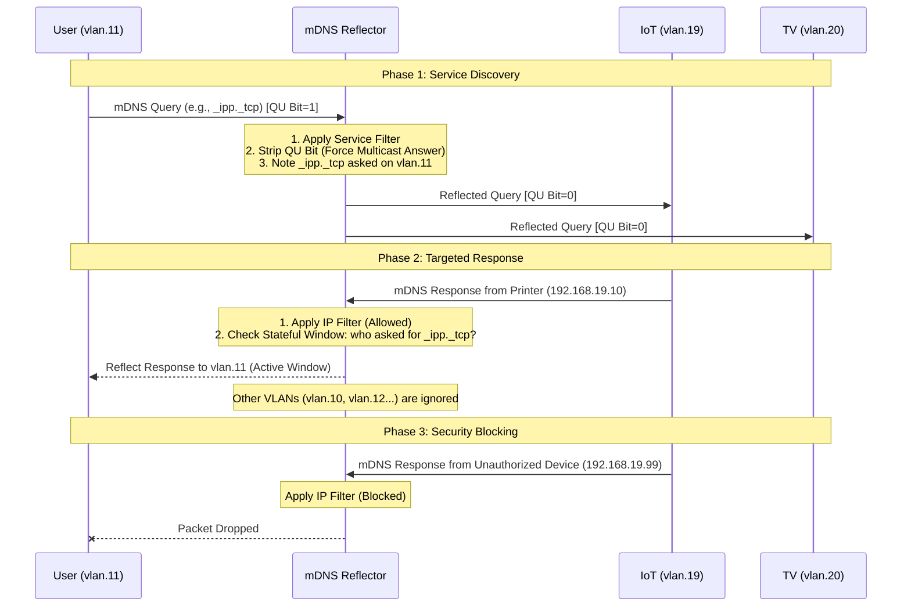

# mdns-reflector

A Go mDNS reflector for networks with many VLANs: it carries mDNS between groups of interfaces under directional rules, with service and source filters.

## Features
- **Interface Grouping:** Manage 50+ VLANs by grouping them (e.g., `users`, `gl_iot`, `gl_tv`).
- **Directional Rule Enforcement:** Define exactly how traffic flows (e.g., Queries: Users -> IoT; Responses: IoT -> Users). A group can never reflect into itself.
- **Service Filter for Queries:** A query is forwarded only if *every* question in it is an allowed service (or a name below one, such as an instance or a subtype), a bare hostname (`host.local.`), or a reverse lookup (`*.in-addr.arpa.`, `*.ip6.arpa.`). Matching is by whole labels, case-insensitive. Queries are not rewritten to drop questions: a query with one disallowed question is not forwarded at all.
- **Source Filter (L3 only):** `allowed_ips` limits which source addresses a rule reflects. It checks the IPv4 source of the packet and nothing else; the records inside a response are not filtered by service. Every packet's source must also lie in a subnet of the interface it arrived on, so an address from one VLAN cannot be claimed on another.
- **Address Record Check:** In reflected responses, A records for any address other than the sender's are removed, and so are AAAA records (the reflector is IPv4-only and cannot check them). If a record cannot be cut out safely (another name in the packet is compressed into it), a response with a foreign A record is dropped, and an AAAA record is left in.
- **Stateful Discovery Window (default on):** A response is reflected to an interface only if that interface forwarded a query, within the last 60 seconds, for a name the response answers. A query that no rule forwarded opens nothing. Set `stateful: false` on a response rule to reflect every response.
- **Multicast Enforcement (QU-bit Stripping):** Clears the "unicast response" bit in forwarded queries so that devices answer by multicast, which the reflector hears and can carry back. Only those bits change; the rest of the packet is forwarded byte for byte.
- **Loop Protection:** Multicast loopback is off and packets from any of the host's own addresses are ignored, so the reflector never re-reflects its own transmissions (or avahi's on the same host).
- **Interface Churn:** Every 30 seconds the reflector re-reads the host's interfaces: VLANs that appear later or are recreated are joined, and address changes are picked up.
- **Malformed Packets Dropped:** Packets are validated on the wire (names, compression pointers, lengths); anything malformed is dropped, never forwarded partially rewritten.

## System Requirements (Linux/Raspberry Pi)

Before running the reflector on a system with many VLANs, the following OS-level configurations are required:

### 1. VLAN Support
The `8021q` kernel module must be loaded to support sub-interfaces:
```bash
sudo modprobe 8021q
# To make permanent:
echo "8021q" | sudo tee -a /etc/modules
```

### 2. Increase Multicast Group Limit
Linux defaults to a maximum of 20 multicast group memberships per socket. Since this app joins the mDNS group on every interface, more than 20 interfaces need a higher limit (the deb ships `/etc/sysctl.d/mdns-reflector.conf` and applies it on install if the current limit is lower):
```bash
# Add to /etc/sysctl.conf
net.ipv4.igmp_max_memberships = 100

# Apply immediately
sudo sysctl -p
```

### 3. avahi-daemon on the same host
The reflector binds `0.0.0.0:5353` with `SO_REUSEADDR` and `SO_REUSEPORT`, so it can run next to avahi-daemon; both get every multicast packet. Turn avahi's own reflector off (`enable-reflector=no`, the default) so the two don't both reflect.

## Architecture & Logic
1. **Listener:** Binds once to `0.0.0.0:5353` and joins the mDNS multicast group (`224.0.0.251`) on all configured sub-interfaces, sending with IP TTL 255 (RFC 6762). It needs no capabilities.
2. **Packet Inspection:** Parses each packet on the wire: header, questions, records and compression pointers. The receiving interface comes from `IP_PKTINFO`.
3. **State Tracking:** When a query from a "User" VLAN is forwarded, the reflector notes each name it asked for on that interface for 60 seconds.
4. **Reflection:** Packets are reflected across interfaces as received, except for the QU bit in queries and the address records removed from responses.

## How it Works



## Understanding the Logs (mDNS Record Types)

In the logs, you will see various DNS record types. These are standard mDNS record types (RFC 6762) used during discovery:

| Type | Full Name | Purpose in Discovery |
| :--- | :--- | :--- |
| **PTR** | Pointer Record | **Discovery:** Maps a service type (e.g., `_ipp._tcp`) to a specific device name. This is usually the first packet seen. |
| **SRV** | Service Record | **Resolution:** Provides the **Port Number** and the **Hostname** for a specific service. |
| **TXT** | Text Record | **Details:** Contains key-value pairs with extra info (e.g., printer model, scan resolution, AirPlay version). |
| **A** | Address (IPv4) | **Location:** Maps a hostname (e.g., `printer.local`) to its **IPv4 address**. |
| **AAAA** | Address (IPv6) | **Location:** Maps a hostname to its **IPv6 address**. |
| **ANY** | Any Record | **Probe:** A generic query often sent by OSs during startup to find any available records for a name. |

### Example Discovery Flow in Logs:
1. **Query (PTR):** "Who is an AirPlay device?"
2. **Response (PTR):** "I am 'Roku Event Back'."
3. **Query (SRV/TXT):** "What port does 'Roku Event Back' use and what are its features?"
4. **Query (A):** "What is the IP address of 'X02800M8GX3H.local'?"

## Configuration Example

```yaml
# config.yaml
interfaces:
  - { name: "vlan.10", group: "users" }
  - { name: "vlan.19", group: "gl_iot" }
  - { name: "vlan.20", group: "gl_tv" }
  # ... add more interfaces ...

rules:
  # 1. Users can ONLY send specific service queries to Service Networks.
  # Hostname (host.local.) and reverse (in-addr.arpa / ip6.arpa) questions
  # are always allowed, so clients can resolve the devices they discover.
  - from: "users"
    to: ["gl_iot", "gl_tv"]
    types: ["query"]
    filter:
      allowed_services:
        - "_ipp._tcp"            # Printing
        - "_printer._tcp"
        - "_scanner._tcp"        # Scanning
        - "_airplay._tcp"        # Apple AirPlay
        - "_googlecast._tcp"     # Chromecast
        - "_spotify-connect._tcp"
        - "_services._dns-sd._udp" # General Meta-Query

  # 2. IoT Network only sends RESPONSES to Users (from specific IPs), and
  # only to user VLANs that asked (stateful is on by default)
  - from: "gl_iot"
    to: ["users"]
    types: ["response"]
    filter:
      allowed_ips:
        - "192.168.19.10" # Printer
        - "192.168.19.11" # Scanner

  # 3. TV Network only sends RESPONSES to Users
  - from: "gl_tv"
    to: ["users"]
    types: ["response"]
```

The config is checked strictly at startup: unknown keys, a rule without `types`, an empty `to`, a group in its own `to`, a duplicate interface or a non-IPv4 `allowed_ips` entry stop the service with exit code 78 (systemd does not restart it; `journalctl -u mdns-reflector` says why).

## Testing Guide

Use `avahi-browse` on a client machine to verify discovery.

### 1. Test Printers (IPP)
```bash
avahi-browse -rt _ipp._tcp
```

### 2. Test Apple AirPlay (TVs/Audio)
```bash
avahi-browse -rt _airplay._tcp
```

### 3. Test Google Cast / Chromecast
```bash
avahi-browse -rt _googlecast._tcp
```

### 4. Search all services (Meta-query)
```bash
avahi-browse -at
```

## Logging & Troubleshooting

The reflector uses structured logging via Go's `log/slog`. Since it runs under systemd, timestamps are provided by journald — the application output contains only level, message, and key-value fields.

### Log Levels

Set the log level in `config.yaml`:

```yaml
log_level: "info"   # default — shows service responses, startup, errors
```

| Level | What you see |
| :--- | :--- |
| **`debug`** | Everything — every reflected query and response, every dropped packet and why |
| **`info`** | Startup, rules, interfaces appearing, disappearing or changing address, shutdown |
| **`warn`** | Recoverable issues (multicast join failures, interfaces without an IPv4 address, forwarding failures) |
| **`error`** | Fatal errors; the process exits and systemd restarts it |

### Viewing Logs

```bash
# Follow logs in real time
journalctl -u mdns-reflector -f

# Show last 100 lines
journalctl -u mdns-reflector -n 100

# Logs since last boot
journalctl -u mdns-reflector -b
```

### Filtering Logs

Structured fields make it easy to filter with `grep`:

```bash
# Is the printer responding?
journalctl -u mdns-reflector -f | grep "src_ip=192.168.19.10"

# What's reaching a specific VLAN?
journalctl -u mdns-reflector -f | grep "to=vlan.10"

# Show only responses (debug level)
journalctl -u mdns-reflector -f | grep "Response reflected"

# What's coming from the IoT network?
journalctl -u mdns-reflector -f | grep "from_group=gl_iot"
```

### Example Log Output

At `info` level (default) — startup and interface changes:
```
INFO Interface up interface=vlan.19 group=gl_iot index=7 prefixes=[192.168.19.0/24]
INFO mDNS Reflector started interfaces=12
```

At `debug` level — every reflected packet and every drop:
```
DEBUG Query reflected src_ip=192.168.10.50 from=vlan.10 from_group=users to=vlan.19 questions="[_ipp._tcp.local. (PTR)]"
DEBUG Response reflected src_ip=192.168.19.10 from=vlan.19 from_group=gl_iot to=vlan.10 records="[_ipp._tcp.local. (PTR)]"
```

### Quick Troubleshooting Checklist

1. **No logs at all?** Check the service is running: `systemctl status mdns-reflector`
2. **Queries visible but no responses?** The service device may not be in `allowed_ips`, its address may not be in the subnet of the interface it sits on, or it's responding via Unicast (check QU-bit stripping).
3. **Responses dropped?** With `stateful` on (the default) the client's VLAN must have forwarded a query for a name the response answers within the window.
4. **Too much noise?** Keep `log_level: "info"`. Switch to `"debug"` only when actively troubleshooting.

## Deployment

### Option 1: Debian Package (Recommended)
Building a `.deb` package automates the system requirements (sysctl, 8021q) and sets up a systemd service.

1. **Build the package:**
   ```bash
   # For Raspberry Pi (default)
   make package
   
   # For Intel/AMD (x86_64)
   make package ARCH=amd64
   ```
2. **Install:**
   ```bash
   sudo dpkg -i bin/mdns-reflector_1.0.0_arm64.deb
   ```
   A first install copies `/etc/mdns-reflector/config.yaml.example` to `config.yaml` (root:mdns-reflector, 0640); upgrades never touch `config.yaml`. The service stays stopped until the config is valid. `apt remove` keeps the config and the user; `apt purge` deletes both.

> **Note:** The package version is derived automatically from the latest git tag. See [Versioning](#versioning) below.

### Option 2: Manual Binary Deployment
1. **Build:**
   ```bash
   # For Raspberry Pi
   make cross-compile
   
   # For Intel/AMD
   make cross-compile ARCH=amd64
   ```
2. **Copy to target:**
   Transfer the binary from `bin/` and `config.yaml` to your machine.
3. **Run** (no root or capabilities needed):
   ```bash
   ./bin/mdns-reflector-arm64 --config config.yaml
   ```

## Versioning

The package version is pulled automatically from the latest git tag (stripping the leading `v`). If no tag exists, it defaults to `0.0.0-dev`.

### Creating a version tag
```bash
# Tag the current commit
git tag v1.0.0

# Or tag with an annotation
git tag -a v1.0.0 -m "Initial release"

# Push the tag to the remote
git push origin v1.0.0
```

### Updating the version
```bash
git tag v1.1.0
git push origin v1.1.0
```

### Overriding the version manually
```bash
make package VERSION=2.0.0
```
